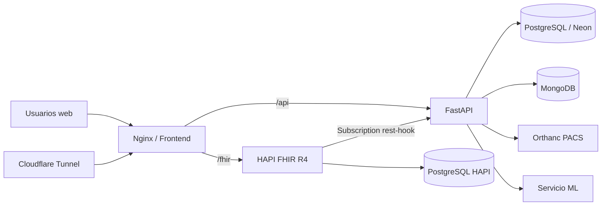
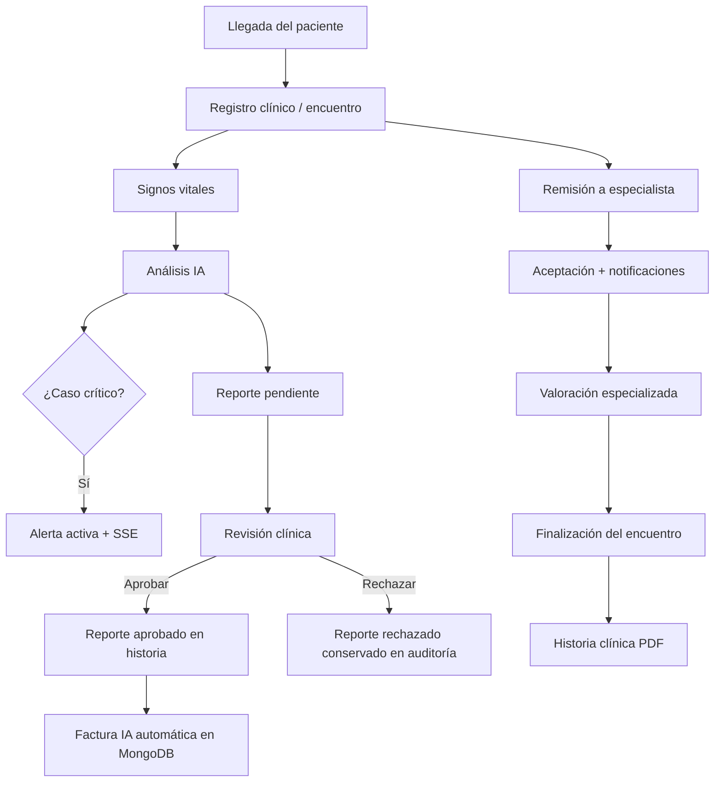

# Sistema de apoyo al triaje hospitalario — Salud Digital 2026-2

Proyecto académico orientado al flujo de urgencias del Hospital San Andrés de Tumaco E.S.E. El sistema integra registro clínico, apoyo al triaje con IA, remisiones, PACS, interoperabilidad FHIR, facturación, auditoría y notificaciones en tiempo real.

> La IA es un **apoyo a la decisión**. El profesional de salud conserva la decisión final del nivel de triaje.

## Arquitectura



Servicios levantados con `docker compose up -d`: `api`, `frontend`, `ml`, `mongodb`, `orthanc`, `hapi-fhir`, `hapi-postgres` y `cloudflared`.

## Flujo clínico principal



## Roles

- `Admin`: usuarios, desbloqueos, restauración y auditoría.
- `Medico`: pacientes, encuentros, IA, aprobación/rechazo, remisiones y atención.
- `Especialista`: remisiones recibidas y atención de pacientes remitidos.
- `Paciente`: consulta únicamente su propia información.
- `Contable`: facturación; no accede a información clínica.

## Seguridad

- JWT para autenticación.
- Autorización por rol y aislamiento del paciente.
- Contraseñas almacenadas con hash.
- Bloqueo después de 3 intentos fallidos y desbloqueo solo por Admin.
- CORS restringido, cabeceras de seguridad y rate limiting en Nginx.
- Secretos fuera de Git: solo se versionan `.env.example` y `back/example.pass.env`.
- Minimización y seudonimización del payload enviado al servicio ML.
- Auditoría de acciones relevantes.

## Datos e IA

### Dataset tabular

La base homologada combina KTAS y NHAMCS 2022. Después del preprocesamiento se usan 7.443 registros de entrenamiento y 1.861 de prueba. El clustering usa k-means con `k=5` y genera sintéticos dentro de cada grupo. Ver `docs/DATASETS.md`.

### Modelo supervisado

Modelo: regresión logística multinomial + 11 signos de alarma clínicos.

Categorías:
- `critico`: niveles I-II;
- `medio`: nivel III;
- `no_critico`: niveles IV-V.

Resultados de prueba almacenados en `back/preprocesamiento/salida_ia/metricas_modelo.json`: AUC crítico 0.765; sensibilidad crítica 0.658; VPP crítico 0.363; F1 macro 0.517; kappa ponderado 0.409; subtriaje grave (crítico→no crítico) 0.091.

Umbral de alerta: `P(crítico) >= 0.38` o red de seguridad (`SpO2 < 88 %` o `PAS < 90 mmHg`).

### Análisis de sesgo

Se evaluó el comportamiento por fuente, sexo y grupo de edad. La principal diferencia observada está en el grupo de 18-39 años, con sensibilidad crítica menor (0.489) y mayor proporción de críticos clasificados como no críticos (0.205). Por ello el sistema no automatiza la decisión final: el profesional revisa el resultado y las reglas de seguridad clínica complementan al modelo.

## PACS e imágenes

Orthanc funciona como PACS. Las imágenes se asocian a pacientes y se consultan desde su ficha. El dataset público real definitivo de imágenes está aún en selección y debe completarse en `docs/DATASETS.md` antes de la entrega final.

## Interoperabilidad FHIR

HAPI FHIR R4 corre como servicio Docker y se expone mediante Nginx bajo `/fhir/`. La API mantiene recursos clínicos y registra una `Subscription` `rest-hook` para reaccionar cuando llega una nueva `Observation`. La reacción genera auditoría y notificación al médico responsable.

## Sistema reactivo

El canal SSE autenticado está disponible en `/api/eventos/stream?token=...`. Las notificaciones son persistentes y el endpoint `/api/pendientes` devuelve contadores de reportes por revisar, remisiones y alertas activas.

Eventos principales documentados en `docs/EVENTOS.md`:
- remisión creada → notificación al especialista;
- remisión aceptada → notificación al médico remitente;
- reporte IA aprobado → factura automática;
- cuenta bloqueada → notificación a Admin;
- Observation FHIR → notificación al médico;
- alerta crítica → aviso persistente hasta reconocimiento y escalamiento.

## Facturación

La facturación se almacena en MongoDB. Solo `Contable` y `Admin` pueden operarla. La aprobación de un reporte IA genera automáticamente una factura enlazada mediante `reporte_id`. Ver `docs/CONTABILIDAD.md`.

## Historia clínica

La historia integra encuentros, observaciones, diagnósticos, notas, exámenes, prescripciones, remisiones e IA aprobada. El PDF excluye reportes IA pendientes o rechazados.

## Mapa normativo

| Norma | Referencia aplicada | Control técnico del proyecto |
|---|---|---|
| Ley 1581 de 2012 | Art. 4, principios de finalidad, circulación restringida, seguridad y confidencialidad | RBAC, JWT, aislamiento por paciente, seudonimización/minimización, auditoría y secretos fuera del repositorio |
| Ley 2015 de 2020 | Arts. 1-3: historia clínica electrónica e interoperabilidad | HAPI FHIR R4, recursos interoperables y continuidad de información |
| Resolución 866 de 2021 | Reglamentación de elementos de datos clínicos relevantes para IHCE | Uso de FHIR, identificadores y codificación clínica interoperable |
| Resolución 1995 de 1999 | Arts. 13, 14 y 16: custodia, acceso y seguridad de historia clínica | Acceso por rol, historia clínica, PDF, auditoría y controles de integridad/acceso |
| Resolución 3100 de 2019 | Estándares de procesos prioritarios, historia clínica y registros del prestador | Trazabilidad del proceso de atención, registros clínicos estructurados y evidencia del encuentro |

## Despliegue

1. Crear `.env` en la raíz usando `.env.example` como referencia.
2. Crear `back/pass.env` local usando `back/example.pass.env` como referencia.
3. Verificar que Docker Desktop esté activo.
4. Desde la raíz ejecutar:

```powershell
docker compose up -d --build
```

5. Verificar:

```powershell
docker compose ps
```

Frontend local: `http://localhost:5500`.

El servicio `cloudflared` publica el frontend/Nginx. La misma URL pública sirve para:
- aplicación: `/`;
- API: `/api/...`;
- HAPI FHIR: `/fhir/...`.

Como se usa Quick Tunnel, la URL puede cambiar al recrear `cloudflared`; antes de entregar se debe copiar la URL vigente en `tester.yaml`.

## Contrato de evaluación

`tester.yaml` debe permanecer en la raíz. Antes de la evaluación completar:

```yaml
url_publica: "https://URL-VIGENTE.trycloudflare.com"
```

No se debe modificar la estructura de rutas sin actualizar también `tester.yaml`.

## Comprobaciones antes de entregar

```powershell
# Todo el stack
docker compose up -d --build
docker compose ps

# Confirmar que secretos NO estén versionados
git ls-files | findstr /I ".env pass.env"
```

El segundo comando no debe devolver `.env` ni `back/pass.env`.

También se debe verificar manualmente el guion de demostración: alerta crítica, aprobación IA → factura, remisión y aceptación, Observation FHIR, bloqueo/desbloqueo, PDF y auditoría, sin recargar la página.
