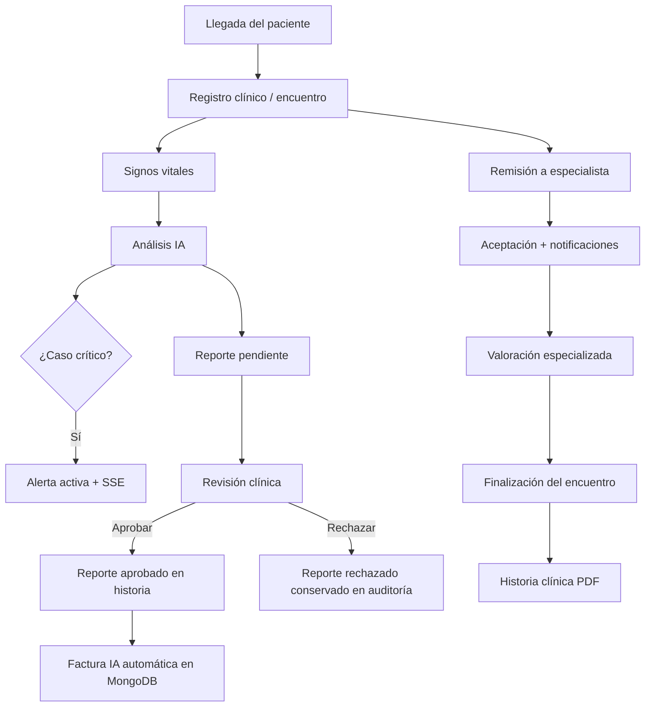
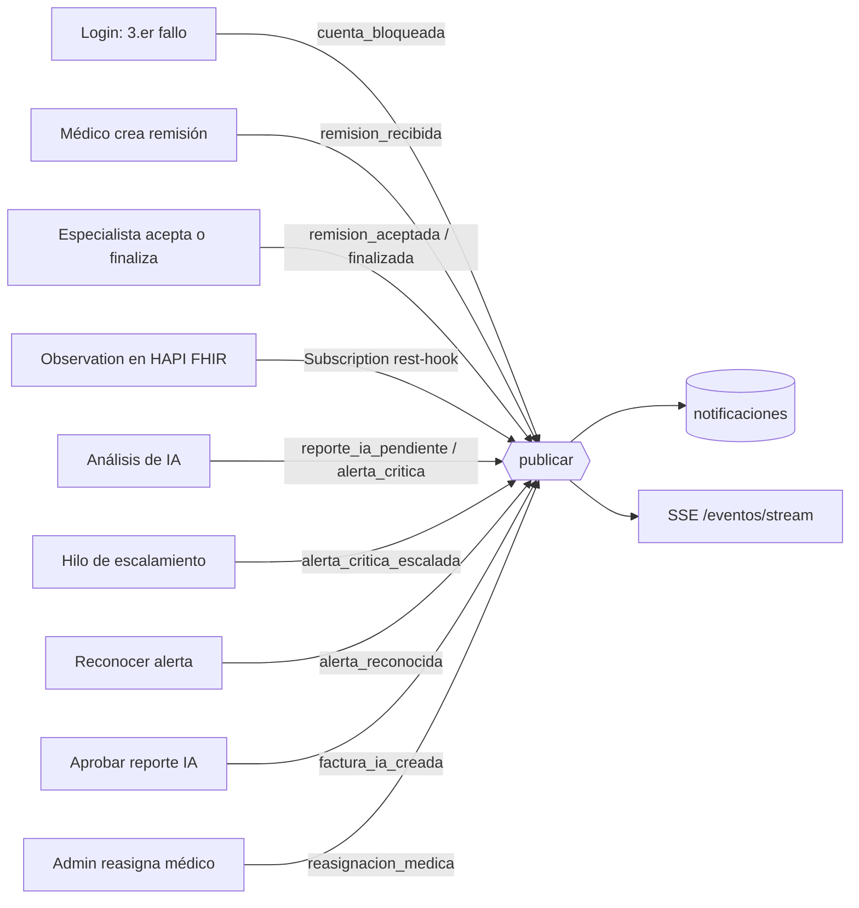

# Sistema de apoyo al triaje hospitalario — Salud Digital 2026-2

Proyecto académico orientado al flujo de urgencias del Hospital San Andrés de Tumaco E.S.E. El sistema integra registro clínico, apoyo al triaje con IA, remisiones, PACS, interoperabilidad FHIR, facturación, auditoría y notificaciones en tiempo real.

> La IA es un **apoyo a la decisión**. El profesional de salud conserva la decisión final del nivel de triaje.

## Documentación

| Documento | Contenido |
|---|---|
| [`docs/DATASETS.md`](docs/DATASETS.md) | Datasets tabular y de imágenes: fuentes, licencias, filtros, clusters, sintéticos |
| [`docs/MODELO.md`](docs/MODELO.md) | Modelo de IA completo: regla de decisión, umbrales, métricas, comparación de modelos, sesgo por subgrupo, limitaciones e integración (R10, R12, R20) |
| [`docs/EVENTOS.md`](docs/EVENTOS.md) | Catálogo de eventos en tiempo real y alertas |
| [`docs/CONTABILIDAD.md`](docs/CONTABILIDAD.md) | Facturación en MongoDB |
| [`docs/LEYES.md`](docs/LEYES.md) | Marco normativo y controles técnicos |
| [`dataset_imagenes/`](dataset_imagenes/) | Imágenes DICOM cargadas en el PACS y su documentación |

## Arquitectura

```mermaid
flowchart LR
    U[Usuarios web] --> N[Nginx / Frontend]
    N -->|/api| A[FastAPI]
    N -->|/fhir| H[HAPI FHIR R4]
    A --> P[(PostgreSQL / Neon)]
    A --> M[(MongoDB)]
    A --> O[Orthanc PACS]
    A --> ML[Servicio ML]
    H --> HP[(PostgreSQL HAPI)]
    H -->|Subscription rest-hook| A
    C[Cloudflare Tunnel] --> N
```



Servicios levantados con `docker compose up -d` (9): `api`, `frontend`, `ml`, `mongodb`, `orthanc`, `hapi-fhir`, `hapi-postgres`, `cloudflared` y `postgres` (PostgreSQL local alternativo; la base clínica por defecto es Neon, externa).

## Flujo clínico principal



## Roles

- `Admin`: usuarios, desbloqueos, restauración y auditoría.
- `Medico`: pacientes, encuentros, IA, aprobación/rechazo, remisiones y atención.
- `Especialista`: remisiones recibidas y atención de pacientes remitidos.
- `Paciente`: consulta únicamente su propia información.
- `Contable`: facturación; no accede a información clínica.

## Seguridad

- JWT para autenticación.
- Autorización por rol y aislamiento del paciente.
- Contraseñas almacenadas con hash.
- Bloqueo después de 3 intentos fallidos y desbloqueo solo por Admin.
- CORS restringido, cabeceras de seguridad y rate limiting en Nginx.
- Secretos fuera de Git: solo deben versionarse `.env.example` y `back/example.pass.env`. Se comprueba con `git ls-files` (ver "Comprobaciones").
- Minimización y seudonimización del payload enviado al servicio ML.
- Auditoría de acciones relevantes.

## Datos e IA

### Dataset tabular

La base homologada combina KTAS y NHAMCS 2022. Después del preprocesamiento se usan 7.443 registros de entrenamiento y 1.861 de prueba. El clustering usa k-means con `k=5` y genera sintéticos dentro de cada grupo. Ver [`docs/DATASETS.md`](docs/DATASETS.md) (fuentes, filtros, clusters, sintéticos) y [`docs/MODELO.md`](docs/MODELO.md) (cómo funciona el modelo).

### Modelo supervisado

Modelo: regresión logística multinomial + 11 signos de alarma clínicos.

Categorías:
- `critico`: niveles I-II;
- `medio`: nivel III;
- `no_critico`: niveles IV-V.

Resultados de prueba almacenados en `back/preprocesamiento/salida_ia/metricas_modelo.json`: AUC crítico 0.765; sensibilidad crítica 0.658; VPP crítico 0.363; F1 macro 0.517; kappa ponderado 0.409; subtriaje grave (crítico→no crítico) 0.091.

Umbral de alerta: `P(crítico) >= 0.38` o red de seguridad (`SpO2 < 88 %` o `PAS < 90 mmHg`).

Documentación completa del modelo (regla de decisión, métricas, matriz de confusión e intervalos de confianza): [`docs/MODELO.md`](docs/MODELO.md).

### Análisis de sesgo

Se evaluó el comportamiento por sexo y grupo de edad. La principal diferencia observada está en el grupo de 18-39 años, con sensibilidad crítica menor (0.489) y mayor proporción de críticos clasificados como no críticos (0.205). Por ello el sistema no automatiza la decisión final: el profesional revisa el resultado y las reglas de seguridad clínica complementan al modelo. La tabla por subgrupo está en [`docs/MODELO.md`](docs/MODELO.md), sección 9.

## PACS e imágenes

Orthanc funciona como PACS. Las imágenes se asocian a pacientes y se consultan desde su ficha. Los datasets de imágenes, su licencia, el número de imágenes cargadas y la trazabilidad por paciente están en `docs/DATASETS.md`, sección `## Imagen`.

## Interoperabilidad FHIR

HAPI FHIR R4 corre como servicio Docker y se expone mediante Nginx bajo `/fhir/`. La API mantiene recursos clínicos y registra una `Subscription` `rest-hook` para reaccionar cuando llega una nueva `Observation`. La reacción genera auditoría y notificación al médico responsable.

## Sistema reactivo

El canal SSE autenticado está disponible en `/api/eventos/stream?token=...`. Las notificaciones son persistentes y el endpoint `/api/pendientes` devuelve contadores de reportes por revisar, remisiones y alertas activas.

Eventos principales documentados en `docs/EVENTOS.md`:
- remisión creada → notificación al especialista;
- remisión aceptada → notificación al médico remitente;
- reporte IA aprobado → factura automática;
- cuenta bloqueada → notificación a Admin;
- Observation FHIR → notificación al médico;
- alerta crítica → aviso persistente hasta reconocimiento y escalamiento.

### Diagrama de eventos



El catálogo completo, con destinatarios y datos de cada evento, está en `docs/EVENTOS.md`.

## Facturación

La facturación se almacena en MongoDB. Solo `Contable` y `Admin` pueden operarla. La aprobación de un reporte IA genera automáticamente una factura enlazada mediante `reporte_id`. Ver `docs/CONTABILIDAD.md`.

## Historia clínica

La historia integra encuentros, observaciones, diagnósticos, notas, exámenes, prescripciones, remisiones e IA aprobada. El PDF excluye reportes IA pendientes o rechazados.

## Mapa normativo

Resumen; el detalle artículo por artículo y las limitaciones están en `docs/LEYES.md`.

| Norma | Referencia aplicada | Control técnico del proyecto |
|---|---|---|
| Ley 1581 de 2012 | Art. 4, principios de finalidad, circulación restringida, seguridad y confidencialidad | RBAC, JWT, aislamiento por paciente, seudonimización/minimización, auditoría y secretos fuera del repositorio |
| Ley 2015 de 2020 | Arts. 1-3: historia clínica electrónica e interoperabilidad | HAPI FHIR R4, recursos interoperables y continuidad de información |
| Resolución 866 de 2021 | Reglamentación de elementos de datos clínicos relevantes para IHCE | Datos clínicos relevantes (incluye prioridad de triaje y diagnóstico CIE-10) expuestos en recursos FHIR R4; la resolución no nombra FHIR, es decisión de diseño |
| Resolución 1995 de 1999 | Arts. 13, 14 y 16: custodia, acceso y seguridad de historia clínica | Acceso por rol, historia clínica, PDF, auditoría y controles de integridad/acceso |
| Resolución 5596 de 2015 | Criterios técnicos del triage: cinco categorías; el triage no puede usarse para negar atención | Niveles 1–5; la IA solo apoya, la decisión es del profesional |
| Resolución 3100 de 2019 | Estándares de procesos prioritarios, historia clínica y registros del prestador | Trazabilidad del proceso de atención, registros clínicos estructurados y evidencia del encuentro |

## Trazabilidad con los requisitos

| Req. | Tema | Dónde se documenta |
|---|---|---|
| R01 | Roles y permisos | README, "Roles" |
| R02 | Bloqueo de cuenta | README, "Seguridad"; `docs/EVENTOS.md` (`cuenta_bloqueada`) |
| R03 | Seguridad (JWT, hash, CORS, cabeceras, límite de peticiones, secretos) | README, "Seguridad"; `docs/LEYES.md` |
| R04 | URL pública (Cloudflare Tunnel) | README, "Despliegue" |
| R05 | Servicios y arquitectura | README, "Arquitectura" |
| R06 | PACS e imágenes | README, "PACS e imágenes"; [`docs/DATASETS.md`](docs/DATASETS.md), sección `## Imagen`; [`dataset_imagenes/`](dataset_imagenes/) |
| R07 | Dataset, clusters y sintéticos | [`docs/DATASETS.md`](docs/DATASETS.md), sección `## Tabular` (clusters en 1.7 y sintéticos en 1.8) |
| R08 | Remisiones | `docs/EVENTOS.md` |
| R09 | Facturación en MongoDB | `docs/CONTABILIDAD.md` |
| R10 | Reporte de IA con aprobación del profesional | [`docs/MODELO.md`](docs/MODELO.md), sección 12 |
| R11 | Historia clínica en PDF | README, "Historia clínica" |
| R12 | Minimización y seudonimización del payload | [`docs/MODELO.md`](docs/MODELO.md), sección 12 |
| R13 | Auditoría | README, "Seguridad"; `docs/LEYES.md` |
| R14 | Eliminación lógica y restauración. El médico solo elimina pacientes que él creó; el Admin los ve en "Pacientes eliminados" y los restaura | `docs/LEYES.md`, "Controles transversales" |
| R15 | Interoperabilidad FHIR R4 | README, "Interoperabilidad FHIR" |
| R16 | Interfaz web | README, "Arquitectura" |
| R17 | Tiempo real (SSE) | README, "Sistema reactivo"; `docs/EVENTOS.md` |
| R18 | Bandeja persistente y pendientes | `docs/EVENTOS.md` |
| R19 | Reacciones automáticas | `docs/EVENTOS.md`; `docs/CONTABILIDAD.md` |
| R20 | Alertas críticas, reconocimiento y escalamiento. La alerta persiste hasta que se reconoce; si no, escala sola a los Admin (pantalla "Alertas escaladas"); no hay botón de escalamiento manual | [`docs/EVENTOS.md`](docs/EVENTOS.md), "Escalamiento"; [`docs/MODELO.md`](docs/MODELO.md), sección 5 |
| R21 | Subscription FHIR | README, "Interoperabilidad FHIR"; `docs/EVENTOS.md` (`observacion_fhir`) |
| R22 | Documentación y marco normativo | README; `docs/LEYES.md` |

## Despliegue

1. Crear `.env` en la raíz usando `.env.example` como referencia.
2. Crear `back/pass.env` local usando `back/example.pass.env` como referencia.
3. Verificar que Docker Desktop esté activo.
4. Desde la raíz ejecutar:

```powershell
docker compose up -d --build
```

5. Verificar:

```powershell
docker compose ps
```

Frontend local: `http://localhost:5500`.

El servicio `cloudflared` publica el frontend/Nginx. La misma URL pública sirve para:
- aplicación: `/`;
- API: `/api/...`;
- HAPI FHIR: `/fhir/...`.

Como se usa Quick Tunnel, la URL pública cambia si se recrea `cloudflared`; la URL vigente está en `tester.yaml`.

## Contrato de evaluación

`tester.yaml` está en la raíz y declara la URL pública, los usuarios de prueba y las rutas del API que usa la evaluación. La estructura de rutas y `tester.yaml` se mantienen sincronizados.

## Comprobaciones del despliegue

```powershell
# Todo el stack
docker compose up -d --build
docker compose ps

# Secretos no versionados
git ls-files | findstr /I ".env pass.env"
```

El segundo comando no debe devolver `.env` ni `back/pass.env`.

Guion de demostración: alerta crítica, aprobación IA → factura, remisión y aceptación, Observation FHIR, bloqueo/desbloqueo, PDF y auditoría, sin recargar la página.
