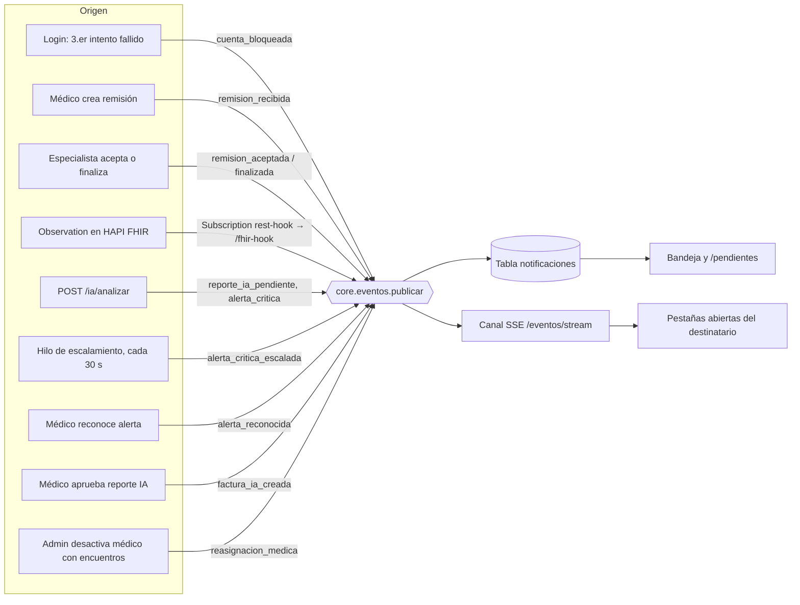

# Catálogo de eventos

El sistema avisa en tiempo real mediante Server-Sent Events. Todo aviso pasa por
`core/eventos.publicar()`, que hace dos cosas:

1. Guarda una fila en la tabla `notificaciones` (bandeja persistente, R18).
2. Empuja el evento por el canal `GET /eventos/stream?token=...` a las pestañas
   abiertas del destinatario (R17).

Los eventos se dirigen a **usuarios concretos**, nunca a "todos". Así, un evento
clínico no llega al paciente ni al contable (alcance por rol, R17).

## Formato de cada evento

    {
      "id": 12,
      "tipo": "remision_recibida",
      "mensaje": "Nueva remisión a Cardiología: Ana Pérez",
      "fecha": "2026-10-03T21:10:05+00:00",
      "leida": false,
      "paciente_id": 1083877566,
      "...": "datos propios del hecho (remision_id, especialidad...)"
    }

## Diagrama de eventos

Cada evento se guarda **antes** de empujarse por SSE: si el usuario no estaba conectado, lo ve al abrir la bandeja.  En el análisis de IA, los avisos se publican después de confirmar la transacción.

## Eventos

| Evento (`tipo`) | Quién lo dispara | A quién llega | Reacción | Datos extra |
|---|---|---|---|---|
| `cuenta_bloqueada` | 3.er intento fallido de login (`auth/service.py`) | Todos los Admin activos | Aviso en bandeja y en vivo; el Admin puede desbloquear | `usuario_bloqueado`, `documento_usuario` |
| `remision_recibida` | Médico crea una remisión (`POST /remisiones`) | El especialista destino | Aviso; sube `remisiones_recibidas` | `remision_id`, `id_encuentro`, `especialidad`, `medico_remitente` |
| `remision_aceptada` | Especialista acepta (`PATCH /remisiones/{id}/aceptar`) | El médico remitente | Aviso; baja `remisiones_recibidas` del especialista | `remision_id`, `especialidad`, `observacion` |
| `remision_finalizada` | El especialista dueño marca como terminada una remisión **ya aceptada** (`PATCH /remisiones/{id}/finalizar`); si no está aceptada responde 409 | Únicamente el médico remitente (el paciente y el contable no lo reciben) | Aviso en bandeja y en vivo; la remisión pasa a `finalizada`; se audita `FINALIZAR` en `remisiones` | `remision_id`, `id_encuentro`, `especialidad`, `observacion`, `puede_revisar_cierre_encuentro` |
| `observacion_fhir` | Un sistema externo crea o actualiza una `Observation` en HAPI FHIR. HAPI la envía a `/fhir-hook` mediante la Subscription `triaje-observaciones` (rest-hook) | El médico responsable del encuentro activo del paciente; si no hay, los Admin | Aviso en bandeja y en vivo; fila `RECIBIR_FHIR` con `origen = FHIR` en `auditoria_cambios` | `origen`, `fhir_id`, `loinc`, `nombre`, `valor` |

> **Rechazo de una remisión.** `PATCH /remisiones/{id}/rechazar` (solo el especialista destino, remisión `pendiente`) cambia el estado a `rechazada` y registra `RECHAZAR_REMISION` en la auditoría. No publica notificación: el médico remitente ve el nuevo estado y la observación en su lista de remisiones.

> `remision_finalizada` es adicional: no reemplaza el flujo obligatorio de R19 (`remision_aceptada`). Avisa al médico que la valoración especializada terminó para que pueda revisar el caso antes de cerrar el encuentro.

> **Encuentros finalizados:** las alertas y los contadores de `/pendientes` solo cuentan encuentros que no están finalizados. Al cerrar un encuentro dejan de aparecer.

## Eventos de IA y alertas críticas (R10, R20)

| Evento (`tipo`) | Quién lo dispara | A quién llega | Reacción |
|---|---|---|---|
| `reporte_ia_pendiente` | `POST /ia/analizar/{documento}` (médico, especialista o admin) | Médico responsable del encuentro; si no tiene, quien pidió el análisis; si fue un admin, todos los médicos | Sube `reportes_por_revisar` en `/pendientes`. Baja al aprobar o rechazar |
| `alerta_critica` | El mismo análisis, cuando el modelo marca alerta: P(crítico) ≥ 0,38 **o** red de seguridad (SpO2 < 88 % o PAS < 90 mmHg) | Los mismos destinatarios del reporte | Se crea la alerta `activa`, sube `alertas_activas` y aparece el aviso persistente hasta que se reconoce |
| `alerta_critica_escalada` | El sistema (hilo de la API), si la alerta sigue `activa` después de `ALERTA_ESCALAR_MINUTOS` (5 por defecto) | Todos los admin | La alerta queda abierta para cualquier médico. Se audita `ESCALAR_ALERTA` con origen `SISTEMA` |
| `alerta_reconocida` | `PATCH /alertas/{id}/reconocer` | El destinatario (o todos los médicos si no tenía), quien la reconoció y, si estaba escalada, los admin | El aviso persistente desaparece en todas sus pantallas abiertas; baja `alertas_activas` |
| `factura_ia_creada` | Un Médico/Especialista aprueba un reporte IA | Contable y Admin | Se crea automáticamente la factura en MongoDB, ligada por `reporte_id`; la vista de facturación se refresca sin recargar |
| `reasignacion_medica` | Admin desactiva un médico con encuentros activos (`DELETE /usuarios/{doc}?medico_reemplazo=`) | El médico de reemplazo | Los encuentros activos pasan al reemplazo; se audita `REASIGNAR_MEDICO` por cada encuentro |

Paciente y Contable no reciben ninguno de estos eventos, ni ven ni reconocen alertas (403).

### Escalamiento (R20.4)
- **Tiempo:** 5 minutos sin reconocimiento (variable `ALERTA_ESCALAR_MINUTOS`). En urgencias, un paciente crítico se valora en minutos (nivel 2 de ESI/KTAS: ≤ 10-15 min), así que el escalamiento debe ocurrir antes de ese plazo.
- **Mecanismo:** un hilo de la API revisa cada 30 s las alertas `activa` sin escalar y más antiguas que el umbral (`FOR UPDATE SKIP LOCKED`, para no chocar con un reconocimiento simultáneo).
- **A quién:** a todos los usuarios con rol Admin. Desde ese momento cualquier médico puede reconocerla, además del destinatario original.
- **Auditoría:** `ESCALAR_ALERTA`, con `origen = 'SISTEMA'` y sin usuario, porque nadie la ejecuta.

## Documentos relacionados

[`CONTABILIDAD.md`](CONTABILIDAD.md) (factura automática de IA) · [`MODELO.md`](MODELO.md) (análisis de IA y alertas) · [`LEYES.md`](LEYES.md) · [README](../README.md)
